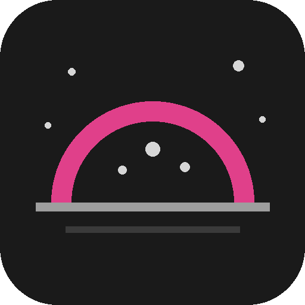
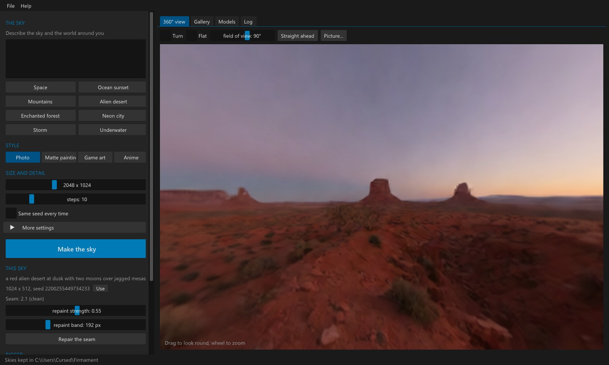
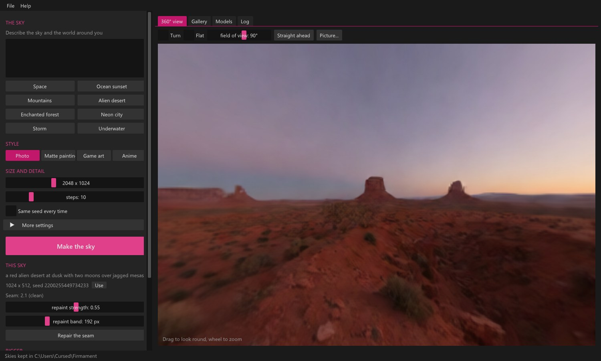

 

  

 

  
  
  
  

  
  
  

 

  

# Firmament

**360° skyboxes from a prompt, made on your own GPU.** Describe a sky and the world under it, and Firmament paints
the whole sphere round you as an equirectangular panorama, shows it in a 360° view you drag to look round, repairs
the seam, upscales it to 8K and exports it for game engines. It runs Krea 2 Turbo with a 360° panorama LoRA through
[ComfyUI](https://github.com/comfyanonymous/ComfyUI), and opens on your phone too.
It comes two ways: a **desktop app for Windows in C++** (no Python, no ComfyUI: download, unzip, describe a sky)
and the original **web app** on ComfyUI that opens on your phone too. Part of
**[Atelier](https://github.com/CursedPrograms/Atelier)**. **[Website](https://cursedprograms.github.io/Firmament/)**

## Features

- **Text to skybox:** a 2048 × 1024 equirectangular panorama from a description, in four styles (photo, matte
  painting, game art, anime), with eight ready-made scenes to start from. A 1024 × 512 quick draft is there for trying
  ideas out.
- **Made for 360°:** [mickmumpitz's Krea 2 360° LoRA](https://huggingface.co/mickmumpitz/Krea2-360-ERP-LoRAs) keeps
  the horizon level, puts the sky and the ground at the poles and makes the left and right edges meet.
- **360° view:** drag (or swipe) to look round, scroll (or pinch) to zoom, Turn to let it spin, Flat to see the whole
  map, Full screen.
- **Seam repair:** every skybox gets a seam score (how much its left and right edges disagree). Fix seam turns the
  panorama half way round, repaints a band across the join on ComfyUI and blends it back in.
- **Upscale:** 2× (4096 × 2048) or 4× (8192 × 4096) with 4x-UltraSharp V2 Lite. The panorama is padded with its
  opposite edge first, so the upscale wraps without a seam.
- **Export:** the panorama PNG (Unity, Unreal, Godot and Blender take it directly), the six cube faces in a zip
  (OpenGL layout: px nx py ny pz nz), or a horizontal cross.
- **On your phone:** when Firmament starts it prints your PC's address and a QR code; the page's *Open on your
  phone* button shows the same code. The page works on phone screens.
- **Jobs:** one at a time on the GPU, in order, with live progress (steps, what ComfyUI is doing) and Cancel. The
  gallery keeps every skybox, with its prompt and seed, in `output/`.
- **12 languages:** English, Japanese, Chinese, Spanish, Korean, French, German, Russian, Serbian, Afrikaans, Yucatec
  Maya and Pennsylvania Dutch (Deitsch).

## The desktop app (C++)

Download **Firmament-win64.zip** from [Releases](https://github.com/CursedPrograms/Firmament/releases), unzip it anywhere
and run `Firmament.exe` (or `install.bat` for Start menu and Desktop shortcuts), or get it through the
[Atelier launcher](https://github.com/CursedPrograms/Atelier). The first time, open the **Models** tab and press
**Get the models** (about 12 GB; downloads carry on where they stopped). It needs an NVIDIA graphics card; on an
RTX 2060 (6 GB) a 1024 x 512 draft takes one to five minutes.

- **The same skies, without Python:** Krea 2 Turbo and the 360° LoRA run by
  [stable-diffusion.cpp](https://github.com/leejet/stable-diffusion.cpp) (CUDA), the model kept loaded between skies, the
  left and right edges joined as it paints, so a seam is rare.
- **Every setting a slider:** size, steps, guidance, the LoRA's strength, shift, sampler and schedule; lock the seed to
  try small changes to the words.
- **The rest of Firmament:** the eight scenes and four styles, a 360° view (drag, zoom, turn, flat), the gallery,
  the seam score and repair, 2x / 4x Real-ESRGAN upscaling (photo or art), and the panorama PNG, the six cube faces
  in a zip and the cross.
- Skies are kept in `Pictures\Firmament` (or `Firmament` in your user folder when Windows guards Pictures), each with
  a text file of how it was made.

Build it: Visual Studio 2022, CMake, the CUDA 12 toolkit, and stable-diffusion.cpp built as a shared library with CUDA
(`cmake -DSD_CUDA=ON -DSD_BUILD_SHARED_LIBS=ON -DCMAKE_CUDA_RUNTIME_LIBRARY=Shared`), then `cpp\build.bat` with `SDCPP`
pointing at it. The code is in `cpp/src/`: `engine.cpp` (stable-diffusion.cpp), `pano.cpp` (the panorama maths, ported
from `firmament/skybox.py`), `viewer.cpp` (the 360° view), `gui.cpp` (the window), `splash.cpp`.

## The web app: setup

1. **ComfyUI** with [ComfyUI-GGUF](https://github.com/city96/ComfyUI-GGUF) (for the GGUF model). Firmament looks
   for it in `C:\cc\ComfyUI` (set `COMFYUI_DIR` for another folder) and starts it when it isn't running.
2. **The models**, where ComfyUI finds them (its `models/` folders, or `extra_model_paths.yaml`):

   | File | ComfyUI folder | From |
   |---|---|---|
   | `krea2_turbo_bf16-Q4_0.gguf` | `diffusion_models` | Krea 2 Turbo GGUF |
   | `qwen3vl_4b_fp8_scaled.safetensors` | `text_encoders` | [Comfy-Org/Krea-2](https://huggingface.co/Comfy-Org/Krea-2) |
   | `wan_2.1_vae.safetensors` | `vae` | [Comfy-Org/Krea-2](https://huggingface.co/Comfy-Org/Krea-2) |
   | `krea2_t2i_360_erp_lora_v1.safetensors` | `loras` | [mickmumpitz/Krea2-360-ERP-LoRAs](https://huggingface.co/mickmumpitz/Krea2-360-ERP-LoRAs) |
   | `4x-UltraSharpV2_Lite.safetensors` | `upscale_models` | 4x-UltraSharp V2 (for Upscale) |

3. **Run** `run.bat` (or `run.ps1`, or `./run.sh` on Linux). The first time it sets up Firmament's Python (3.12,
   in `venv/`). Then open **http://127.0.0.1:7880**, or scan the QR code it prints with your phone.

The top bar says *ComfyUI ready* when everything is there, or names what's missing.

**Speed:** on an RTX 2060 (6 GB), sampling runs at about 16 seconds a step: the first 2048 × 1024 skybox took 4.5
minutes, models loading included. Fix seam took a minute and a half.

**Settings** (environment variables): `FIRMAMENT_PORT` (7880), `FIRMAMENT_HOST` (`0.0.0.0`, so phones on the WiFi can
open it; `127.0.0.1` keeps it on this PC), `COMFY_SERVER` (`http://127.0.0.1:8188`).

## How it works

| File | What it does |
|---|---|
| `app.py` | The server: the page, the job queue, the gallery and the exports |
| `firmament/pipeline.py` | The ComfyUI jobs: generate, fix seam, upscale; the LoRA's prompt template |
| `firmament/comfy.py` | Queues workflows on ComfyUI, follows their progress, fetches the images |
| `firmament/skybox.py` | The panorama maths: the seam strip and blend, wrap padding, cube faces, the cross |
| `firmament/lan.py` | The PC's address on the network and the QR code |
| `workflows/*.json` | The ComfyUI graphs (API format) |
| `ui/` | The page: `viewer.js` (the WebGL 360 view), `app.js`, `style.css`, `lang/` |

The panorama's convention: its centre looks along −Z, so the cube map's `nz` face is the middle of the picture.

 

## License

Firmament's code is under the [MIT License](LICENSE). The models it runs are not part of it: Krea 2 and the 360° LoRA
are under the Krea 2 Community License. See [NOTICE](NOTICE).

---

 

<a href="https://github.com/Farica-Kimora">Farica☆Kimora</a> © Cursed Entertainment 2026

 

 

  

